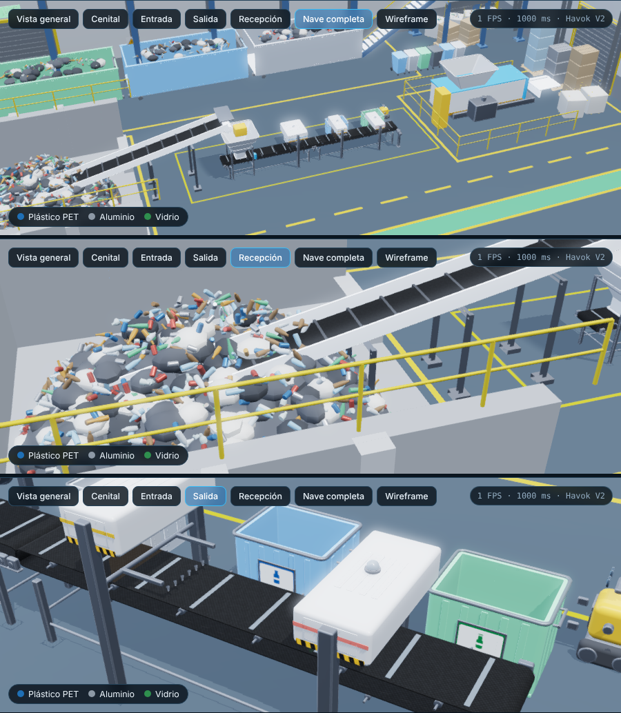

# Modelos 3D — Planta de reciclaje en Lumbreras

Responsable: Afry (Angel Fernando Rivera Yado) — Especialista 3D y Entornos.
Todos los modelos se generan con código (`npm run generar:modelos`) y se guardan como `.glb`.

## Reglas del proyecto que se cumplen
- Formato: **solo `.glb`** (no `.obj`). Las texturas van **incrustadas** dentro del `.glb` (PNG interno); no hay imágenes sueltas.
- Sin TypeScript ni frameworks: el generador es JavaScript puro (ES modules), sin dependencias (`node:zlib` y `node:fs`).
- Unidades en metros, eje Y hacia arriba. Maquinaria y piezas: origen en la base y centrado. Entorno: coordenadas de mundo.


*(Capturas de la aplicación real: nave completa, foso de recepción y zona de salida.)*

## Qué contiene `public/assets/models/`

### Piezas a reciclar — `materiales/` (3 originales + 6 variantes)
Cada material tiene una pieza principal y dos variantes. El pool de objetos reparte las variantes por turnos, así la banda
mezcla formas y colores **sin cambiar la física**: todas caben en el cilindro de colisión de su material
(`PROPIEDADES_FISICAS_MATERIAL`, validado por `test/entorno-y-variantes.test.mjs`).

| Material | Principal | Variantes |
|---|---|---|
| Plástico PET | `botella_plastico.glb` (agua 500 ml) | `botella_plastico_cola.glb` (refresco, líquido oscuro, tapa roja) · `botella_plastico_deportiva.glb` (tapa pull-cap) |
| Aluminio | `lata_aluminio.glb` (355 ml roja) | `lata_aluminio_dorada.glb` (cerveza) · `lata_aluminio_slim.glb` (250 ml azul) |
| Vidrio | `botella_vidrio.glb` (verde) | `botella_vidrio_ambar.glb` · `frasco_vidrio.glb` (conservas, tapa metálica) |

Las variantes se declaran en `src/mocks/materiales.json` (campo `variantes`). Para agregar otra: generar el `.glb`, listarlo ahí y
en `public/manifest.json`, y correr `npm run qa`.

### Maquinaria — `maquinaria/`
Paleta del equipo (`maq_*`: aluminio cepillado, grafito, blanco cerámico y acentos azul/ámbar/coral). Detalle industrial real:
postes con placas de anclaje, carcasas con paneles y rejillas, franjas de peligro, chumaceras y motorreductor con aletas,
tolva hueca con borde enrollado, tambor magnético con 18 segmentos, colector de aire con válvulas, contenedores con costillas y
cartel con pictograma.

| Archivo | Nodos que anima o usa el código |
|---|---|
| `banda_transportadora.glb` | `banda`, `rodillo_inicio`, `rodillo_fin`, `rodillo_soporte_*`, `motor` |
| `tolva_alimentacion.glb` | `tolva_cuerpo`, `tolva_boca`, `compuerta_salida` |
| `separador_aluminio.glb` | `tambor_magnetico`, `aspas_tambor`, `luz_estado` |
| `escaner_optico_plastico.glb` | `boquilla_1..7` (anclan en su base y crecen hacia abajo), `luz_estado` |
| `desviador_vidrio.glb` | `compuerta_pivote` (nodo en la bisagra), `luz_estado` |
| `contenedor_plastico/aluminio/vidrio.glb` | colisionadores de 0.9 × 0.7 × 0.7 m |
| `robot_walle.glb` | lo genera `tools/generar-walle.mjs` (código conservado tal cual) |

### Entorno de la nave — `entorno/` (nuevo)
Decoración estática en coordenadas de mundo, fusionada por material (pocas llamadas de dibujo). Nave de 32 × 20 m y 8.5 m de alto.

| Archivo | Contenido |
|---|---|
| `nave.glb` | muros, columnas, portones de muelle, señalética (salidas, advertencias, extintores) y marcas de piso |
| `nave_techo.glb` | cerchas, correas, cubierta, grúa puente, luminarias y ductos |
| `recepcion.glb` | foso de hormigón con pila de residuos mezclados, banda inclinada hasta la boca de la tolva, montacargas y pacas |
| `salida.glb` | empacadora horizontal, pacas de plástico/aluminio/cartón en tarimas, vallas y big bags |
| `patio.glb` | 3 contenedores roll-off cargados, botes de ruedas por color, big bags, estantería y entresuelo con cabina de control |

Detalles de integración (`src/engine3d/entornoPlanta.js`):
- Los muros y el techo son de **una sola cara**: desde fuera de la nave son transparentes, así la cámara puede alejarse.
- `nave_techo.glb` se **oculta solo** cuando la cámara sube por encima de la cubierta (vistas *Cenital* y *Nave completa*).
- Ninguna malla del entorno es seleccionable ni participa en física o ensamblaje. La línea funcional (x −4.2 a 5.3, z −2.4 a 0.9) y
  el carril de WALL-E quedan libres.
- Para medir rendimiento sin decoración: `escena.alternarEntorno(false)` (o quitar `modelos.entorno` del manifest).
- Vistas de cámara nuevas: **Recepción** y **Nave completa** (botones `data-camara`).
- Los materiales `entorno_*` se calibran menos brillantes en `pbrEnhancer.js` para que la maquinaria siga siendo la protagonista.

## Contrato con el código (no cambiar sin avisar)
`pbrEnhancer.js` calibra por **nombre de material** y `sceneController.js` anima por **nombre de nodo**.
- Materiales de piezas: `pet_transparente[_cola|_azul]`, `vidrio_verde|vidrio_ambar|vidrio_claro`, `aluminio`, `lata_banda_roja*`,
  `chapa_corona*`, `tapa_azul*`, `etiqueta`. El tinte de cada variante sale del sufijo del nombre.
- Maquinaria: prefijo `maq_` (`maq_cont_*` para contenedores). Entorno: prefijo `entorno_` (el test lo verifica).
- Pivotes: rodillos y tambor simétricos (giran sobre su centro, eje Z); boquillas ancladas en su base; compuerta en la bisagra.

## Regenerar
```bash
npm run generar:modelos     # todo menos WALL-E
npm run generar:walle       # solo robot_walle.glb
npm run qa                  # pruebas + validadores de .glb y SVG + auditoría
```
Estructura: `tools/generar-modelos.mjs` (orquesta) y `tools/lib/` (`geometria`, `texturas`, `glb`, `piezas-materiales`,
`piezas-maquinaria`, `entorno-base`, `piezas-entorno`). Las medidas de cada pieza están en su función; los colores y propiedades
PBR, en la tabla `MAT` de `tools/lib/glb.mjs`. El entorno es determinista (semilla fija): regenerar no cambia su aspecto.

## Validar formatos (solo .gltf / .glb)
`node tools/validar-modelos.mjs` rechaza `.obj`, `.fbx`, `.stl`, etc., y comprueba que cada `.glb` esté bien formado (cabecera, buffers,
accesores, texturas incrustadas). Código de salida 0 si cumple, 1 si falla.

## Rendimiento (a vigilar)
El entorno suma unos 130 mil triángulos (≈ 5 MB de modelos). Si en algún equipo los FPS bajan: `alternarEntorno(false)`, o reducir
`n` y `nBolsas` de las pilas en `tools/lib/piezas-entorno.mjs` y regenerar.
